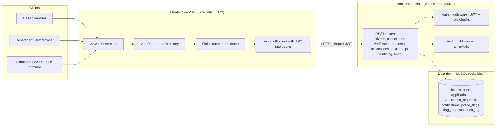
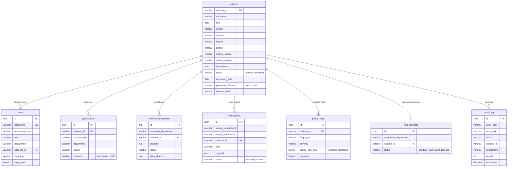
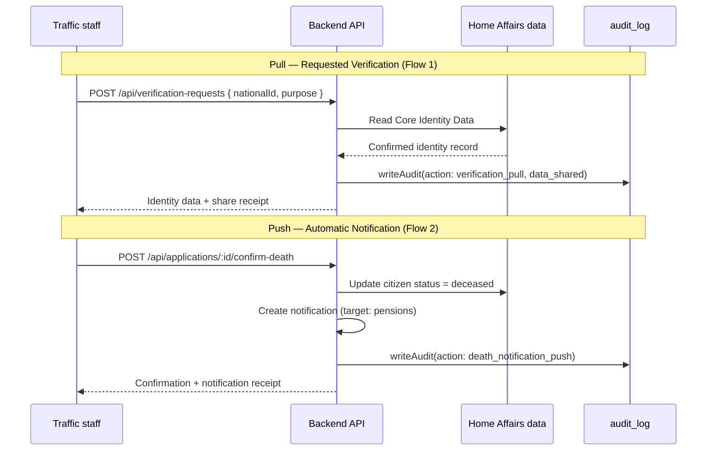

# System Architecture — Boitsibiso National ID Hub (Kopano)

BIHC3110 Human Computer Interaction — Integrated Government Services System, Lesotho

This document describes the technical architecture of the working prototype: a full-stack web
application connecting Home Affairs with Traffic, Finance, Pensions, Police, and Passport
Services around a single verified citizen identity record.

---

## 1. Architecture Overview

The system is a classic three-tier web architecture:

- **Presentation tier** — Vue 3 single-page application (Vite dev server, port 5173)
- **Application tier** — Node.js + Express REST API (port 4000)
- **Data tier** — MySQL database (`boitsibiso`) accessed through a `mysql2/promise` connection pool

A separate **simulated USSD channel** is served from the same SPA (route `/#/ussd`) and talks to
dedicated backend endpoints, so the feature-phone path exercises the same identity anchor and
audit pipeline as the web path.



---

## 2. Technology Stack

| Layer | Technology | Notes |
|---|---|---|
| Frontend framework | Vue 3 (Composition API) | SPA, hash-based routing |
| Build tool | Vite | Dev server on `:5173`, production build via `npm run build` |
| State management | Pinia | `auth` store (session), `demo` store (persona switcher) |
| HTTP client | Axios | Centralised client with JWT interceptor and auto re-login |
| Backend runtime | Node.js | CommonJS modules |
| Backend framework | Express 4 | JSON REST API |
| Database | MySQL 8 (`mysql2/promise`) | Connection pool (limit 10), `utf8mb4` |
| Auth | JWT (`jsonwebtoken`) + `bcryptjs` | Stateless Bearer tokens, role claims |
| Audit | Custom middleware | Every share/action written to `audit_log` |
| Utilities | `uuid`, `morgan`, `cors`, `dotenv` | IDs, request logging, cross-origin, config |

---

## 3. Frontend Architecture

### 3.1 Structure

```text
frontend/src/
  App.vue               Root shell
  main.js               App bootstrap (Pinia + Router)
  api/client.js         Axios instance: base URL, JWT attach, 401 retry
  router/index.js       Route table (hash history)
  store/auth.js         Authenticated user session state
  store/demo.js         Demo persona profiles and profile switcher
  views/                Screen components (citizen/ and staff/ namespaces)
```

### 3.2 Screen-to-route mapping (design doc traceability)

The 14 screens from the Design & Build Guide map to routes as follows:

| Design screen | Route | Component |
|---|---|---|
| 1 — Login / Identity Verification | `/#/` | [DemoHome.vue](frontend/src/views/DemoHome.vue) |
| 2 — Citizen Dashboard | `/#/citizen/dashboard` | [Dashboard.vue](frontend/src/views/citizen/Dashboard.vue) |
| 3 — Request a Service | `/#/citizen/request-service` | [RequestService.vue](frontend/src/views/citizen/RequestService.vue) |
| 4 — Application Tracking + data-sharing feed | `/#/citizen/tracking` | [Tracking.vue](frontend/src/views/citizen/Tracking.vue) |
| 5 — USSD Flow | `/#/ussd` | [Ussd.vue](frontend/src/views/citizen/Ussd.vue) |
| 6 — Accessibility Settings | `/#/citizen/accessibility` | [Accessibility.vue](frontend/src/views/citizen/Accessibility.vue) |
| 7 — Staff Login / Role Dashboard | `/#/staff/dashboard` | [StaffDashboard.vue](frontend/src/views/staff/StaffDashboard.vue) |
| 8 — Process Application | `/#/staff/process-application` | [ProcessApplication.vue](frontend/src/views/staff/ProcessApplication.vue) |
| 9 — Citizen Profile Management (HA) | `/#/staff/citizen-profile/:nationalId` | [CitizenProfile.vue](frontend/src/views/staff/CitizenProfile.vue) |
| 10 — Notification Rules / Sharing Log | `/#/staff/sharing-log` | [SharingLog.vue](frontend/src/views/staff/SharingLog.vue) |
| 11 — Department Verification Request | `/#/staff/verification-request` | [VerificationRequest.vue](frontend/src/views/staff/VerificationRequest.vue) |
| 12 — Notification Received (Pensions) | `/#/staff/dashboard` (role-scoped queue) | [StaffDashboard.vue](frontend/src/views/staff/StaffDashboard.vue) |
| 13 — Add/View Flag (Police) | `/#/staff/police-flags` | [PoliceFlags.vue](frontend/src/views/staff/PoliceFlags.vue) |
| 14 — Passport Applicant Review | `/#/staff/passport-review` | [PassportReview.vue](frontend/src/views/staff/PassportReview.vue) |

### 3.3 API client behaviour

[client.js](frontend/src/api/client.js) centralises all backend calls:

1. Before every request it ensures a valid demo session exists — if not, it logs in as the
   currently selected demo persona and caches the JWT in `localStorage` (`boitsibiso_token`).
2. The token is attached as an `Authorization: Bearer` header.
3. On a `401` response it transparently re-authenticates once and retries the original request.

This keeps the demo frictionless (persona switching without manual logins) while the backend
still enforces real JWT auth and role checks on every endpoint.

---

## 4. Backend Architecture

### 4.1 Layering

```text
backend/
  server.js               App entry: middleware stack, route mounting, error handler
  src/
    db/
      database.js         Thin data-access helpers: get / all / run over a shared pool
      mysql-config.js     Pool configuration from environment (.env)
    middleware/
      auth.js             requireAuth (JWT verify) + requireRole (role allow-list)
      audit.js            writeAudit — the audit-trail writer used by all share flows
      asyncHandler.js     Wraps async route handlers into Express error handling
    routes/               One module per resource domain (see 4.2)
    utils/jwt.js          Token sign/verify helpers
  scripts/
    migrate-mysql.js      Idempotent schema creation (npm run migrate)
    seed-demo-data.js     Transactional wipe + reseed of demo data (npm run seed)
    reset-demo-passwords.js  Rehashes known demo passwords
```

Requests flow: `server.js` → route module → `requireAuth`/`requireRole` → handler →
`db` helpers → MySQL. Handlers that share or mutate data also call `writeAudit`.

### 4.2 REST API surface

| Base path | Purpose | Key consumers |
|---|---|---|
| `/api/auth` | Login, session profile | All clients |
| `/api/citizens` | Core identity records (the single source of truth) | All departments |
| `/api/applications` | Service requests (ID, licence, death cert, passport, pension) | Citizens + staff queues |
| `/api/verification-requests` | **Pull** pattern: one department requests Core Identity Data from Home Affairs | Traffic, Passport Services |
| `/api/notifications` | **Push** pattern: automatic inter-department notifications (e.g. death registration → Pensions) | Home Affairs → Pensions |
| `/api/police-flags` (+ `/requests`) | Restricted-disclosure flags and flag-access requests | Police, Passport Services |
| `/api/audit-log` | Access & Audit Log reads | Sharing Log, Tracking feed, Citizen Profile |
| `/api/ussd` | Session-oriented text menus for the USSD channel | Simulated phone terminal |
| `/api/health` | Liveness probe | Dev tooling |

### 4.3 Authentication & authorisation

- Login issues a signed JWT carrying `role` and `department` claims.
- `requireAuth` verifies the Bearer token; `requireRole(...roles)` gates endpoints per role.
- Roles: `citizen`, `home_affairs`, `traffic`, `finance`, `pensions`, `police`, `passport`, `admin`.
- This is deliberately demo-grade (no refresh tokens, no rate limiting) — sufficient to demo
  role-scoped views, not production security.

---

## 5. Data Model (MySQL `boitsibiso`)

All entity tables are anchored to `citizens.national_id` — the single verified identity.



**Design intent:**

- `citizens` is the only table holding Core Identity Data — departments never duplicate it.
- `verification_requests.data_shared` and `notifications.payload` record *what* was shared, so
  the audit story is reconstructable per citizen.
- `police_flags.visible_flag_only` enforces the restricted-disclosure principle: other
  departments see that a flag exists, never case details.
- `audit_log` is indexed on `(national_id, timestamp)` to make per-citizen timeline queries
  (Tracking feed, Sharing Log) fast.

---

## 6. Integration & Data-Sharing Patterns

The two sharing patterns from the design brief are implemented as first-class mechanisms:



- **Pull** — `/api/verification-requests`: on-demand, logged at the moment of request.
- **Push** — `/api/notifications`: rule-triggered (e.g. confirmed death certificate
  automatically opens a Pensions case), logged at the moment of dispatch.
- **Restricted disclosure** — `/api/police-flags`: Police control what leaves their domain;
  other departments see flag status only, and full access requires an approved `flag_request`.

Every one of these writes to `audit_log`, which surfaces in the UI on the citizen Tracking
feed, the Home Affairs Sharing Log, the Citizen Profile access log, and the Passport Review
screen — making the trust backbone visible rather than implicit.

---

## 7. Cross-Cutting Concerns

| Concern | Approach |
|---|---|
| Accessibility | Dedicated USSD channel (no smartphone assumption), accessibility settings screen (language toggle, large text), `preferred_channel` / `literacy_level` on the citizen record |
| Auditability | `writeAudit` middleware called on every share, status change, and sensitive read; single append-only `audit_log` table |
| Traceability | Citizen-visible data-sharing feed derived from the same audit data staff see |
| Config | `.env` for DB credentials and port; sensible localhost defaults for classroom demoing |
| Demo data | 39 seeded citizens, 6 department staff accounts + admin; `npm run seed` resets everything transactionally |
| Error handling | Centralised Express error handler returns generic 500s (no stack leakage); `asyncHandler` wraps all async routes |

---

## 8. Running the System

Prerequisites: Node.js (v18+) and a local MySQL 8 server.

```powershell
# Backend — terminal 1
Push-Location backend
npm install
npm run migrate    # create schema
npm run seed       # load demo data
npm start          # API on http://localhost:4000
Pop-Location

# Frontend — terminal 2
Push-Location frontend
npm install
npm run dev        # SPA on http://localhost:5173
Pop-Location
```

- Web app: `http://localhost:5173`
- Simulated USSD phone: `http://localhost:5173/#/ussd`
- API health check: `http://localhost:4000/api/health`

Demo credentials (citizens log in with National ID as both username and password; staff use
`Password123!`) are listed in [DEMO_CREDENTIALS.md](DEMO_CREDENTIALS.md).

---

## 9. Known Prototype Scoping Decisions

Stated honestly for the write-up — these are deliberate classroom-prototype trade-offs:

1. **Auth is demo-grade** — JWT without refresh, expiry, or lockout; the frontend auto-logs-in
   as the selected persona to keep walkthroughs fast.
2. **Departments are simulated in one backend** — in production each department would own its
   service and expose data through a broker/API gateway; here role + department claims on one
   API simulate that separation.
3. **USSD is simulated in-browser** — no real telco gateway; the interaction model (numbered
   text menus, no colour dependency) is faithful to the constraint being designed for.
4. **MySQL `boitsibiso` is the live store**; `backend/data/boitsibiso.sql` is a legacy SQLite
   artefact from an earlier iteration and is no longer used.
5. **No external identity proofing** — the "verified once" anchor is asserted by seed data
   rather than an enrolment workflow.

---

*Companion documents: `Kopano_Design_and_Build_Guide.md` (screens & flows),
`Kopano_Phase1-2_Summary_Strategy.md` (requirements evidence), `DEMO_CREDENTIALS.md` (demo data).*
